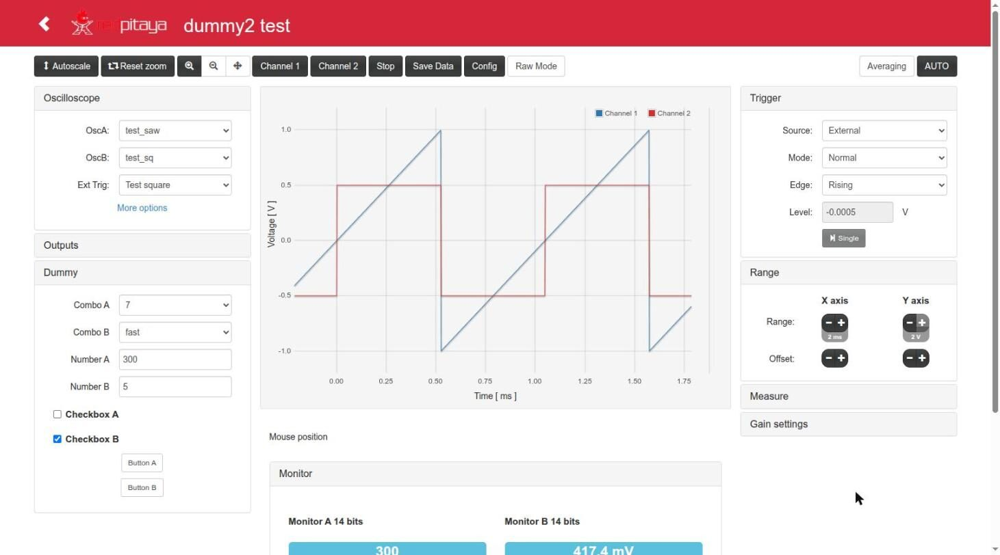

# rp_dummy (rp_dummy2): generator of Red Pitaya Apps

`rp_dummy` creates new **Red Pitaya Apps** with an oscilloscope, your own FPGA logic and a web page whose controls are
already wired to FPGA registers. You describe the controls of the App in an `.ini` file (combo boxes, numbers,
checkboxes, buttons and read-only monitors), run `new_project.py`, and you get a standalone project with:

- an FPGA design (Vivado 2020.1, Ecosystem 2.0 scope) where every control is a register of the `dummy` module
  (`fpga/prj/v0.94/rtl/dummy.v`, bus address `0x40600000`): you only write your logic there;
- the C controller of the App (`controllerhf.so`) and the web interface (`index.html`), connected to those registers;
- a library of Verilog modules ready to instantiate (filters, muxers, counters, debounce, triggers, lookup functions...);
- build, packaging and upload scripts for the board.

It started from the [Scope App v0.95](https://github.com/RedPitaya/RedPitaya/tree/release-v0.95/apps-free/scope) of the
Red Pitaya community applications, and it is the base of the lock-in Apps of the same author
([Lock-in+PID](https://marceluda.github.io/rp_lock-in_pid/)).



## Status and supported ecosystems

| | |
|---|---|
| Version | **2.0.1** (branch `devel2.0`, tag `v2.0.1`; `./new_project.py --version`). Generated Apps start at `0.1.0` and record the generator version. See [CHANGELOG.md](CHANGELOG.md) |
| Red Pitaya OS | **Ecosystem 2.0** (tested on RedPitaya_OS 2.04-35 with STEMlab 125-14) and the older 0.9x/1.0 (packages carry `red_pitaya.bit` + `fpga.conf`; optional Vivado 2015.2 bitstream with `make eco1`; builds, not yet tested on a 0.9x/1.0 board: [Devel.md](doc/Devel.md#ecosystem-09x10)) |
| FPGA tools | Vivado 2020.1 (main design); Vivado 2015.2 only for `make eco1` |
| C toolchain | Linaro `arm-linux-gnueabihf` 4.9 (2014.11 or 2015.02) |
| Host | Linux, Python >= 3.8 (standard library only) |

Every App carries remote control tools: command line tools in `<App>/c/` (registers of the App and of the scope by
name, streaming of the scope over TCP), HTTP endpoints for them in its `nginx.conf` (`/<App>/dummy`, `/<App>/osc`,
`/<App>/streaming`...) and PC-side examples in `resources/` (`stream_receiver.py --board` configures, starts and
receives a streaming in one command): see [doc/Remote.md](doc/Remote.md).

## Quick start

```bash
./new_project.py -n -c my.ini my_app            # check my.ini and print the register map (writes nothing)
./new_project.py -c my.ini -o ~/rp my_app       # create ~/rp/rp_my_app/ with the App my_app/
cd ~/rp/rp_my_app
#   ... write your logic in my_app/fpga/prj/v0.94/rtl/dummy.v ...
source settings.sh                              # Linaro (+ Vivado 2015.2 for make eco1)
LANG=C make                                     # controller + FPGA (Vivado 2020.1) + packages in archive/
cd my_app/target && ./upload_app.sh -r rp-XXXXXX.local
```

Then open `http://rp-XXXXXX.local/my_app/`. `config.ini` in this folder is a complete example of the `.ini` format;
`./new_project.py -h` lists every option.

## Documentation

| File | Contents |
|---|---|
| [doc/Usage.md](doc/Usage.md) | `new_project.py` (options, `.ini` format, validation, exit codes) and the step-by-step procedure to build your own App, including the use of its web interface |
| [doc/App.md](doc/App.md) | What a generated App contains: register map, oscilloscope (inputs, trigger, time ranges, mouse wheel, Raw Mode), outputs and the library of Verilog modules with instantiation examples |
| [doc/Devel.md](doc/Devel.md) | Compilation (environment, Makefile targets, outputs, durations, timing), layout of a generated App, host tests and upload to the board |
| [doc/Remote.md](doc/Remote.md) | Remote control: `c/dummy` and `c/osc` (registers by name), HTTP endpoints, streaming of the scope, Python examples |
| [CHANGELOG.md](CHANGELOG.md) | Changes by version |

## Other resources

- [Write the MicroSD card of a Red Pitaya](https://redpitaya.readthedocs.io/en/latest/quickStart/SDcard/SDcard.html)
- [Red Pitaya developer's guide](https://redpitaya.readthedocs.io/en/latest/developerGuide/devGuideTop.html)

## License

GNU General Public License v3 (see [LICENSE](LICENSE)). Parts of the FPGA design and of the controller come from Red
Pitaya (`(C) Red Pitaya 2013-2025`, see the headers of those files).
