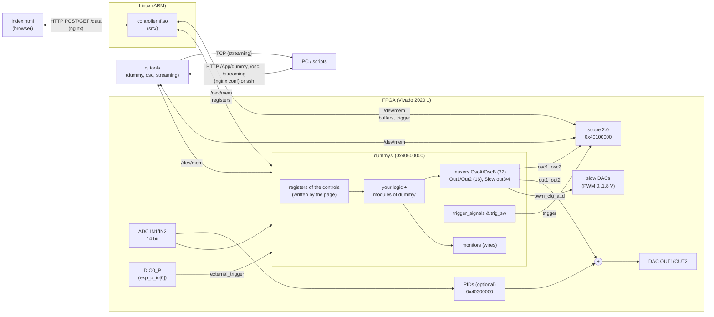

# App: what a generated App contains

> Documented version: rp_dummy2 **2.0.1** (branch `devel2.0`, tag `v2.0.1`). Back to the [README](../README.md).
> Related: [Usage.md](Usage.md) (how to create an App and use its web page), [Devel.md](Devel.md) (build, upload).

Every App made by `new_project.py` is the template `dummy/` with your controls added. This page describes the fixed
parts (signal flow, registers, oscilloscope, outputs) and the library of Verilog modules you can instantiate in
`dummy.v`. Line numbers refer to the template files in this repository (`dummy/...`) unless another file is named.

Contents:

1. [Overview and signal flow](#1-overview-and-signal-flow)
2. [Register map of the dummy module](#register-map-of-the-dummy-module)
3. [Other FPGA blocks](#3-other-fpga-blocks)
4. [Oscilloscope](#oscilloscope)
5. [Outputs](#5-outputs)
6. [Library of Verilog modules](#library-of-verilog-modules)

---

## 1. Overview and signal flow

- **Clock:** all the logic of `dummy.v` runs on the 125 MHz ADC clock (`clk` = `adc_clk`, `red_pitaya_top.sv:822-823`;
  `c_osc_fpga_smpl_freq = 125e6`, `src/fpga.c:52`): one tick = 8 ns.
- **Signals:** IN1/IN2 and OUT1/OUT2 are 14-bit signed (-8192..8191). On the scope 8192 counts = 1 V with the LV jumper
  (the same scale the page uses for `display = volts`, `config_lib.py:1742`).
- **Bus:** the `dummy` module is the slot 6 of the system bus, at `0x40600000` (`red_pitaya_top.sv:821-846`); the C
  controller maps it from `/dev/mem` (`DUMMY_BASE_ADDR`, `src/fpga_dummy.h:24`), and so do the command line tools of
  `c/` (`c/app_regs.h`, see [Devel.md](Devel.md#contents-of-the-package-target) and [Remote.md](Remote.md)).
- **Bus reads** (scheme of `rp_lock-in_pid_h` v2.3.17, generated by `config_tool.py -v`): `sys_ack <= sys_en`,
  `sys_rdata` is loaded only while `sys_ren` = 1 and then holds its value, and every read-only register (wire: `in1`,
  `oscA`, monitors...) is read from a registered copy `<name>_rd` that is held while `sys_ren` = 1 (`[BUS READ COPIES
  DOCK]`, `dummy.v:467-494`; read mux `dummy.v:558-604`). The PS samples `sys_rdata` asynchronously some cycles after the
  acknowledge: a value reloaded every clock could mix bits of two samples. `prj/v0.94/sdc/red_pitaya.xdc:76-82` gives the inputs
  of `i_dummy/sys_rdata_reg` 2 cycles (`set_multicycle_path`).



The web page never talks to the FPGA directly: it sends parameters to the controller (`POST /data`, in chunks of at
most 600 bytes, `index.html:65`) and reads parameters and traces (`GET /data`); the controller copies the parameters
to the registers and reads the registers back on every GET (so the monitors refresh even while the scope waits for a
trigger, `reportes/dummy2/2026-10-23_cp4_fixes.md` F2).

---

## Register map of the dummy module

Base address `0x40600000`. Every register is a 32-bit word; the value is in the low bits (`sys_wdata[n-1:0]`) and
signed registers are read back sign-extended. Writes to read-only addresses are ignored; any other address reads 0
(`default` of the read `case`, generated `dummy.v`). Source: register list of `dummy/config_tool.py:143-197` and the
generated `[FPGA MEMORY DOCK]` of `dummy.v`.

### Template registers (`register_map = fixed`): `0x000`–`0x0FC`

| Offset | Name | Bits | Sign | R/W | Reset | Function |
|---|---|---|---|---|---|---|
| `0x000` | `oscA_sw` | 5 | u | RW | 1 (in1) | Input of the scope channel A muxer (Osc A in the page) |
| `0x004` | `oscB_sw` | 5 | u | RW | 2 (in2) | Input of the scope channel B muxer (Osc B) |
| `0x008` | `osc_ctrl` | 2 | u | RW | 3 | bit 0 `osc1_filt_off`, bit 1 `osc2_filt_off`: bypass of the anti-aliasing/equalization filter of the scope channel (1 = filter off). Goes to the scope in the output port `osc_ctrl_w` = `{12'b0, stream_rate, stream_cmd[0], osc_ctrl}` (`dummy.v:502`; `osc_ctrl_i` of the scope, `red_pitaya_top.sv:610`): while streaming, bit 2 = 1 and the 2.0 scope uses `stream_rate` (bits 19:3) as decimation |
| `0x00C` | `trig_sw` | 8 | u | RW | 0 | External trigger selector: **bit mask** of `trigger_signals` (see [External trigger](#external-trigger)) |
| `0x010` | `out1_sw` | 4 | u | RW | 0 | Input of the OUT1 muxer |
| `0x014` | `out2_sw` | 4 | u | RW | 0 | Input of the OUT2 muxer |
| `0x018` | `slow_out1_sw` | 4 | u | RW | 0 | Slow out 1 muxer (no muxer in the template: output fixed at 0) |
| `0x01C` | `slow_out2_sw` | 4 | u | RW | 0 | Slow out 2 muxer (idem) |
| `0x020` | `slow_out3_sw` | 4 | u | RW | 0 | Slow out 3 muxer |
| `0x024` | `slow_out4_sw` | 4 | u | RW | 0 | Slow out 4 muxer |
| `0x028` | `in1` | 14 | s | R | | ADC IN1 |
| `0x02C` | `in2` | 14 | s | R | | ADC IN2 |
| `0x030` | `out1` | 14 | s | R | | Signal sent to OUT1 by `dummy` (before the PID sum) |
| `0x034` | `out2` | 14 | s | R | | Signal sent to OUT2 by `dummy` |
| `0x038`–`0x044` | `slow_out1`..`slow_out4` | 12 | u | R | | Value of the slow DACs, 0..2496 (see [Outputs](#5-outputs)) |
| `0x048` | `oscA` | 14 | s | R | | Signal of scope channel A |
| `0x04C` | `oscB` | 14 | s | R | | Signal of scope channel B |
| `0x050` | `read_ctrl` | 3 | u | RW | 0 | `[unused, start_clk, Freeze]` (description of `config_tool.py:173`); **not used by the template logic** |
| `0x054` | `stream_ip` | 32 | u | RW | 0 | Streaming: IP of the receiver, a.b.c.d = `a + b*256 + c*65536 + d*16777216` |
| `0x058` | `stream_port` | 32 | u | RW | 6000 | Streaming: TCP port of the receiver (0..65535) |
| `0x05C` | `stream_rate` | 17 | u | RW | 128 | Streaming: decimation of the scope while streaming |
| `0x060` | `stream_cmd` | 32 | u | RW | 0 | Streaming: ≠ 0 = on (`c/streaming` starts `c/stream_tcp_osc_cmd`; the controller does not touch the scope) |
| `0x064`–`0x0FC` | | | | | | Reserved for registers of the template in next versions (e.g. `cnt_clk`, `config_lib.py:1495-1496`). Read 0 |

The four `stream_*` registers are **not parameters of the controller** (`no_param`, `config_tool.py:174-182`): the web
page does not show them and its POSTs do not overwrite them (otherwise any change in the page would stop a streaming).
They are written with `c/dummy` or `/<App>/dummy` (see [Remote.md](Remote.md)). The controller keeps `stream_ip`,
`stream_port` and `stream_rate` in `/tmp/<App>_stream.conf` and writes them back when the App is opened (the bitstream
load resets them; `src/stream_conf.c`, since 2.0.1). Their table for the tools (name,
address, sign, read only, range) is generated by `config_tool.py -m` into `c/dummy.c`, `c/dummy.txt` (CSV) and
`c/app_regs.h` (offsets).

### Registers of your controls: from `0x100`

One word per control of the `.ini`, in the order of the file: `0x100`, `0x104`, ... (`USER_REGS_INDEX`,
`config_lib.py:1493`). Width and sign as in the `.ini`; `combo`, `number`, `checkbox`, `button` are RW, `monitor` is R.
Checkboxes and buttons are written with `|sys_wdata` (any non-zero word sets them to 1). The exact list of an App is:

- printed by `new_project.py -n -c app.ini NAME`;
- in the `[ADDED REGS DOCK]` comment of its `dummy.v`;
- in `src/fpga_dummy.h` (C struct `dummy_reg_t`, padded with `_Static_assert` on every offset, `config_lib.py:934`).

`DUMMY_BASE_SIZE` (mapped size, `src/fpga_dummy.h:26`) is computed by `config_tool.py -m` in whole 4 kB pages
(`config_tool.py:311-313`).

### Legacy map (`register_map = legacy`)

The 20 template registers `0x000`–`0x04C` as above, then the controls from `0x050`, then `read_ctrl` and the four
`stream_*` registers. Only for
compatibility with the old rp_dummy: the addresses of `read_ctrl` and of every control depend on the `.ini`.

---

## 3. Other FPGA blocks

The FPGA is the RedPitaya-FPGA structure (Release_2026.1 as adapted for the lock-in Apps; project `v0.94`, model `Z10`
= STEMlab 125-14). Bus slots of `red_pitaya_top.sv`:

| Slot / address | Block | In the App |
|---|---|---|
| 0 `0x40000000` | Housekeeping (`red_pitaya_hk`) | as in Red Pitaya (LEDs, digital I/O, ID) |
| 1 `0x40100000` | Oscilloscope 2.0 (`rp_scope_com`) | channels from `dummy` (`osc1/osc2`), external trigger from `dummy` (`trigger`) |
| 2 `0x40200000` | ASG (signal generator) | **not included**: bus stub that acknowledges and reads 0 (`red_pitaya_top.sv:679-680`) |
| 3 `0x40300000` | PIDs (`red_pitaya_pid`) | with `include_pids = True`; otherwise stub, outputs 0 (`red_pitaya_top.sv:703-727`) |
| 4 `0x40400000` | Analog mixed signals (`red_pitaya_ams`) | as in Red Pitaya |
| 5 `0x40500000` | Daisy chain | as in Red Pitaya |
| 6 `0x40600000` | **`dummy`** | your module |
| 7 `0x40700000` | | stub |

The DAC outputs are `out1 + pid_out1` and `out2 + pid_out2`, summed in 15 bits and saturated to 14 bits
(`red_pitaya_top.sv:470-475`). The slow analog outputs (`dac_pwm_o`) are driven by the
`pwm_cfg_a..d` ports of `dummy` (`red_pitaya_top.sv:424-428`), not by housekeeping/AMS. `exp_n_io[7]` is the
`digital_modulation` output of `dummy` (0 in the template) unless CAN is enabled (`red_pitaya_top.sv:547-552`).

The optional Vivado 2015.2 design (`fpga_eco1/`, `make eco1`) uses the same `dummy.v` and the 0.9x scope (17-bit
decimation, maximum window 8.6 s; `src/main.c:80`); it can include the ASG (`INCLUDE_GENFUN`), but `new_project.py` always removes it in
this version.

---

## Oscilloscope

The scope is the Red Pitaya oscilloscope 2.0 (`rp_scope_com`, 20-bit decimation, trigger lock) driven by the C
controller of the App (ported from `lock_in+pid_harmonic`). Its channels are **not** the ADCs: they are the outputs
`osc1`/`osc2` of `dummy`, chosen with two 32-input muxers (`muxer_reg5`, registered, 1 clock of latency;
`dummy.v:141, 178`):

| Osc A / Osc B value | Template input |
|---|---|
| 0 | `14'b0` |
| 1 | `in1` (ADC IN1) — default of Osc A |
| 2 | `in2` (ADC IN2) — default of Osc B |
| 3..31 | free (`14'b0`): connect your signals here |

The texts of the Osc A/Osc B combo boxes are the names of the wires connected to the muxer inputs (or `[names]` of
`app.ini`), written by `config_tool.py` ([Usage.md §5.3](Usage.md#53-texts-of-the-combo-boxes)).

### Scope registers used by the controller (`0x40100000`)

From `src/fpga.h:66-224` (C struct `osc_fpga_reg_mem_t`, offsets checked with `_Static_assert`, `src/fpga.c:29-33`):

| Offset | Register | Use |
|---|---|---|
| `0x00` | `conf` | bit 0 arm trigger, bit 1 reset write state machine, bit 2 (R) trigger status, bit 3 arm keep, bit 4 (R) acquisition done (2.0) |
| `0x04` | `trig_source` | 1 immediately, 2/3 ChA rising/falling, 4/5 ChB rising/falling, 6/7 external rising/falling; bit 5 (R) trigger locked (2.0) |
| `0x08` / `0x0C` | `cha_thr` / `chb_thr` | Trigger level, 14 bits |
| `0x10` | `trigger_delay` | Samples stored after the trigger |
| `0x14` | `data_dec` | Decimation, bits [19:0] (2.0) |
| `0x18` / `0x1C` | `wr_ptr_cur` / `wr_ptr_trigger` | Write pointers (14 bits) |
| `0x20` / `0x24` | `cha_hystersis` / `chb_hystersis` | Trigger hysteresis (`OSC_HYSTERESIS` = `0x3F`, `src/fpga.h:65`) |
| `0x28` | `other` | bit 0: average at decimation (Averaging button) |
| `0x2C` | `we_cnt` | (R) samples written since the last arm, before the trigger (pre-trigger history) |
| `0x30`–`0x4C` | `cha_filt_*`, `chb_filt_*` | Equalization filter coefficients |
| `0x90` | `ext_trig_deb_len` | External trigger debounce, ADC clocks: the controller writes 12500 = 100 µs (`OSC_FPGA_EXT_TRIG_DEB_LEN`, `src/fpga.h:41`, `src/fpga.c:138`) |
| `0x94` | `trigger_lock_ctr` | (W) 1 = unlock the trigger after each acquisition (2.0 only; ignored by the 0.9x scope) |
| `0x10000` / `0x20000` | buffers | 16384 samples per channel (`OSC_FPGA_SIG_LEN`, `src/fpga.h:30`) |

### Time ranges and decimation

The controller picks the smallest decimation whose memory (16384 samples) covers the window asked by the page
(`src/main.c:678-697`). Decimations used (`osc_fpga_cnv_time_range_to_dec()`, `src/fpga.c:546`; `time_range`
parameter, `src/main.c:69-81`; units, `time_range_to_time_unit()`, `src/main.c:591-612`):

| `time_range` | Decimation | Sample period | Full memory (16384 samples) | Units of the plot |
|---|---|---|---|---|
| 0 | 1 | 8 ns | 131.1 µs | µs |
| 1 | 8 | 64 ns | 1.05 ms | µs |
| 2 | 64 | 512 ns | 8.39 ms | ms |
| 3 | 128 | 1.02 µs | 16.8 ms | ms |
| 4 | 256 | 2.05 µs | 33.6 ms | ms |
| 5 | 512 | 4.10 µs | 67.1 ms | ms |
| 6 | 1024 | 8.19 µs | 134 ms | ms |
| 7 | 8192 | 65.5 µs | 1.07 s | s |
| 8 | 65536 | 524 µs | 8.59 s | s |
| 9 | 524288 | 4.19 ms | 68.7 s | s |

(Memory = 16384 × 8 ns × decimation.) The range 9 needs the 2.0 scope: with the bitstream of `make eco1` the longest
window is 8.6 s. The X+/X- buttons move in 1-2-5 steps up to the 68.7 s limit (`index.html:3553`); the mouse wheel
zooms between 20 ns and 68.7 s (`index.html:2292`). Verified on RP2 from 131 µs to 50-60 s windows
(`reportes/dummy2/2026-10-23_cp4_retest.md`, F1).

### Trigger

| Parameter | Values | Notes |
|---|---|---|
| Mode (`trig_mode`) | 0 Auto, 1 Normal, 2 Single | Auto: free running when there is no trigger |
| Source (`trig_source`) | 0 Channel 1, 1 Channel 2, 2 External | |
| Edge (`trig_edge`) | 0 rising, 1 falling | Also for External |
| Level (`trig_level`) | V in the page (normalized volts × scale of the channel); **ADC counts in Raw Mode** | Channel sources. The scope compares 14-bit counts: in Raw Mode the controller writes the counts as they are (`rp_osc_trig_level_v()`, `src/worker.c:261`; before 2.0.1 they were taken as volts and saturated at ±8191). Switching Raw Mode converts the level in the page |

Pre-trigger: windows with negative times show samples before the trigger (only those really acquired since the arm,
`we_cnt`). Scope parameters that do not change the acquisition (e.g. your controls) do not re-arm it, so a step made
from the page can trigger a waiting Normal acquisition (`reportes/dummy2/2026-10-22_cp3_1_cp4.md`, issue B).

**AUTO** (auto-set, `src/worker.c`): looks for a signal in both channels, sets Normal on the channel that has it, the
level and a window with some periods, among the 10 time ranges; with a DC signal it sets Auto. In Raw Mode the level
and the Y range are in counts. Every wait has a time limit (it cannot hang the App or nginx; host regression test
`tests/auto_set_harness.c`).

### External trigger

`trigger_signals` (8 bits, `dummy.v:439`) collects the possible trigger sources; bit 0 is `external_trigger` = the
DIO0_P pin (`exp_p_io[0]`; `red_pitaya_top.sv:398, 572, 827`), bits 1..7 are free (`1'b0`). `trig_sw` (Ext Trig) is a bit
mask: the scope receives `|(trigger_signals & trig_sw)`, registered, **as a level** (`dummy.v:451-456`), so the Edge
selector works with External and the scope debounces it (100 µs, register `0x90`).

To add a source, connect your 1-bit signal to a free bit of `trigger_signals` and add the option to the Ext Trig select
of `index.html` by hand, with value `2^bit` (2, 4, 8 ... 128; comment in `index.html:4377-4378`). The template has
`None` (0) and `Pin` (1).

In the page, choosing an Ext Trig other than None sets Source = External and Mode = Normal in the same request
([Usage.md §6.3](Usage.md#63-oscilloscope)).

### Other scope functions of the page

Mouse-wheel zoom (no key / SHIFT time / ALT Y), Reset zoom (one memory at the current decimation, Y ±1 V or ±8192),
Raw Mode (counts), Autoscale, Averaging, Save Data, Measure and Gain settings: see
[Usage.md §6](Usage.md#6-using-the-web-interface).

---

## 5. Outputs

| Output | Source in `dummy.v` | Range |
|---|---|---|
| OUT1 / OUT2 (fast DACs) | 16-input muxers `out1_sw_m` / `out2_sw_m` (`muxer4`, combinational, `dummy.v:232, 251`): 0 = `14'b0` (default), 1 = `in1`, 2 = `in2`, 3..15 free | 14-bit signed, plus the PID outputs if included |
| Slow out 3 / 4 | `muxer_reg4` `slow_out3_sw_m` / `slow_out4_sw_m` (`dummy.v:376-423`): 0 = `14'b10000000000000` (-8192 → 0 V), 1 = `in1`, 2 = `in2`, 3..15 free | 14-bit signed input mapped to 0..1.8 V |
| Slow out 1 / 2 | muxers disabled in the template (`/* DISABLED */`, `dummy.v:323-368`): fixed at 0 V | |
| `digital_modulation` (`exp_n_io[7]`) | `1'b0` (`dummy.v:433`) | 1 bit |

Slow DAC chain (`dummy.v:299-430`): the 14-bit signed signal is offset to `0..16383`, multiplied by 156 (`pipe_mult`,
4 pipeline stages) and divided by 1024 → 12-bit value `0..2496` (registers `0x038`–`0x044`), then `aDACdecoder` builds
the 24-bit PWM configuration (8 MSB = compare value of a 1..156 counter at 250 MHz, 16 LSB = dithering pattern of the 4
LSB over 16 periods; `dummy/aDACdecoder.v:1-40`). Result: about 1.6 MHz PWM, ~100 ksps, 0..1.8 V (comment
`dummy.v:300`; output voltage not measured in these tests, to confirm).

To enable Slow out 1/2, write a muxer for them in `dummy.v` (the commented blocks are a starting point; replace the
lock-in signals by yours) driving `slow_out1_14` / `slow_out2_14`, remove the `assign slow_out1 = 12'd0` lines and
uncomment the scaling lines; then `config_tool.py -a` gives their selects the input names.

---

## Library of Verilog modules

Folder `fpga/prj/v0.94/rtl/dummy/` of every App. Put your own modules there too; `config_tool.py -t` (or `-a`) adds to
the Vivado scripts only the files of the modules instantiated in `dummy.v`
([Usage.md §5.1](Usage.md#51-modules---tcl-scripts--t)). All modules are clocked by `clk` (125 MHz) when they have one;
"latency" counts clock ticks. Descriptions come from the headers of each file (most of them in Spanish).

| Module | File | Function |
|---|---|---|
| [`filtro_pasabajos`](#filtro_pasabajos-low-pass-filter) | `filtro_pasabajos.v` | 1st order low-pass filter (RC), time constant 8 ns·2^(TAU_OFFSET+tau) |
| [`filtro_pasaaltos`](#filtro_pasaaltos-high-pass-filter) | `filtro_pasaaltos.v` | 1st order high-pass filter |
| [`muxer3/4/5`](#muxers) | `muxer3.v`, `muxer4.v`, `muxer5.v` | 8/16/32-input multiplexers, combinational |
| [`muxer_reg3/4/5`](#muxers) | `muxer_reg3.v`, ... | Same, registered output |
| [`UniversalCounter`](#universalcounter) | `UniversalCounter.v` | Up/down counter with clear and load |
| [`dummy_debounce`](#dummy_debounce) | `dummy_debounce.v` | Debounce of a 1-bit signal |
| [`trigger_input`](#trigger_input) | `trigger_input.v` | Pulse on the rising edge of a masked group of signals |
| [`sum_2N`](#sum_2n) | `sum_2N.v` | Sum and mean of 2^N samples |
| [`satprotect`](#satprotect) | `satprotect.v` | Saturation to a smaller width |
| [`signo`](#signo) | `signo.v` | Sign function (±1) |
| [`pipe_mult`](#pipe_mult) | `pipe_mult.v` | Pipelined unsigned multiplier |
| [`fun_pico`](#fun_pico-and-fun_icdf) | `fun_pico.v` + `pico_data.dat` | Lookup function "peak" (2048 entries) |
| [`fun_icdf`](#fun_pico-and-fun_icdf) | `fun_icdf.v` + `icdf_data.dat` | Lookup inverse cumulative distribution (1024 entries) |
| [`rand_gen_uni`](#rand_gen_uni) | `rand_gen_uni.v` | Uniform 32-bit pseudo-random generator (xorshift) |
| [`gen_mod`](#gen_mod) | `gen_mod.v` + `data_*_ss.dat` | Sine/cosine (1f, 2f, 3f) and square references |
| [`aDACdecoder`](#adacdecoder) | `aDACdecoder.v` | 12-bit value → PWM configuration of a slow DAC (used by the template) |
| [`gen_ramp`](#gen_ramp) | `gen_ramp.v` | Triangular ramp between two limits, with a scaled copy |
| [`mult_dsp_14`](#known-problem-mult_dsp_14) | `mult_dsp_14.v` | 14x14 DSP multiplier — **needs a Xilinx core** |

Used by the template itself (always in the tcl): `muxer_reg5`, `muxer4`, `muxer_reg4`, `pipe_mult`, `aDACdecoder`.

### `filtro_pasabajos` (low-pass filter)

First-order IIR low-pass (equivalent to RC). `out = in` when `dis = 1`. Internal accumulator of 58 bits with saturation.

| Parameter / port | Width | Meaning |
|---|---|---|
| `R` | 14 | Width of `in`/`out` |
| `TAU_OFFSET` | 14 | Starting point of the time constant |
| `tau` | 4, unsigned | Time constant `T = 8 ns · 2^(TAU_OFFSET + tau)`, cut-off `f = 1/(2πT)` |
| `dis` | 1 | 1 = bypass |
| `in` / `out` | `R`, signed | |

With `TAU_OFFSET = 14` (`filtro_pasabajos.v:28-52`):

| `tau` | 0 | 1 | 2 | 3 | 4 | 5 | 6 | 7 | 8 | 9 | 10 | 11 | 12 | 13 | 14 | 15 |
|---|---|---|---|---|---|---|---|---|---|---|---|---|---|---|---|---|
| T | 131 µs | 262 µs | 524 µs | 1.05 ms | 2.10 ms | 4.19 ms | 8.39 ms | 16.8 ms | 33.6 ms | 67.1 ms | 134 ms | 268 ms | 537 ms | 1.07 s | 2.15 s | 4.29 s |
| f | 1.21 kHz | 607 Hz | 304 Hz | 152 Hz | 75.9 Hz | 37.9 Hz | 19.0 Hz | 9.49 Hz | 4.74 Hz | 2.37 Hz | 1.19 Hz | 593 mHz | 296 mHz | 148 mHz | 74 mHz | 37 mHz |

General table for `TAU_OFFSET + tau` = 0..31 (8 ns .. 17.2 s) at the end of the file.

```verilog
filtro_pasabajos #(.R(14), .TAU_OFFSET(14)) i_lpf (
    .clk(clk), .rst(rst),
    .tau( tau_4bits ), .dis( 1'b0 ),
    .in ( in1 ), .out( in1_lpf ) );
```

### `filtro_pasaaltos` (high-pass filter)

First-order high-pass, same ports and time-constant formula as the low-pass, **default `TAU_OFFSET = 0`** (`T` from
8 ns to 262 µs for `tau` 0..15, `filtro_pasaaltos.v:34-52`).

```verilog
filtro_pasaaltos #(.R(14), .TAU_OFFSET(10)) i_hpf (
    .clk(clk), .rst(rst), .tau( tau_4bits ), .dis( 1'b0 ), .in( in1 ), .out( in1_hpf ) );
```

### Muxers

| Module | `sel` | Inputs | Output |
|---|---|---|---|
| `muxer3` / `muxer_reg3` | 3 bits | `in0..in7` | |
| `muxer4` / `muxer_reg4` | 4 bits | `in0..in15` | |
| `muxer5` / `muxer_reg5` | 5 bits | `in0..in31` | |

Parameter `RES` (default 14) = width of inputs and output (unsigned ports: signed signals pass unchanged). `muxerN` is
combinational (AND-OR); `muxer_regN` has `clk`, `rst` and a registered output (1 tick latency, 0 after reset).
`config_tool.py` takes the input names of any instance of a module whose name contains `muxer` for the combo box of
the register connected to `.sel` ([Usage.md §5.3](Usage.md#53-texts-of-the-combo-boxes)).

```verilog
muxer4 #(.RES(14)) i_mux_sig (
    .sel ( comboA ),                       // 4-bit combo of app.ini
    .in0 ( 14'b0 ), .in1 ( in1 ), .in2 ( in2 ), .in3 ( numberA ),
    .in4 ( 14'b0 ), .in5 ( 14'b0 ), .in6 ( 14'b0 ), .in7 ( 14'b0 ),
    .in8 ( 14'b0 ), .in9 ( 14'b0 ), .in10( 14'b0 ), .in11( 14'b0 ),
    .in12( 14'b0 ), .in13( 14'b0 ), .in14( 14'b0 ), .in15( 14'b0 ),
    .out ( sig ) );

muxer_reg3 #(.RES(14)) i_mux_reg (
    .clk(clk), .rst(rst), .sel( sel3 ),
    .in0( a ), .in1( b ), .in2( c ), .in3( d ), .in4( 14'b0 ), .in5( 14'b0 ), .in6( 14'b0 ), .in7( 14'b0 ),
    .out( y ) );
```

`resources/code_helpers/muxer_generator.py` generates the Verilog of muxers of other sizes.

### `UniversalCounter`

N-bit counter (`UniversalCounter.v:31-75`). Priority: `syn_clr` (→ 0) > `load` (→ `d`) > count up (`en & up`) or down
(`en & ~up`). `max_tick` = 1 at `2^N-1`, `min_tick` = 1 at 0. Asynchronous `reset`.

| Port | Width | |
|---|---|---|
| `N` (parameter) | default 8 | Width |
| `clk`, `reset`, `en`, `up`, `syn_clr`, `load` | 1 | |
| `d` / `q` | N | Load value / count |
| `max_tick`, `min_tick` | 1 | |

```verilog
UniversalCounter #(.N(32)) i_cnt (
    .clk(clk), .reset(rst),
    .en(1'b1), .up(1'b1), .syn_clr(buttonA), .load(1'b0), .d(32'b0),
    .q(cnt_q), .max_tick(), .min_tick() );
```

### `dummy_debounce`

Debounce state machine (`dummy_debounce.v`): a rise of `in` is accepted after it stays high `2^N0 - 1` ticks
(`db_level` = 1 and a one-tick `db_tick`); a fall after it stays low `2^N1 - 1` ticks. Defaults `N0 = 7` (≈1 µs),
`N1 = 4`. Renamed from `debounce` to avoid the clash with the module of the RedPitaya design.

```verilog
dummy_debounce #(.N0(7), .N1(4)) i_db ( .clk(clk), .reset(rst), .in(pin), .db_level(pin_db), .db_tick(pin_rise) );
```

### `trigger_input`

`trig_tick` goes high for `2^N - 1` ticks after a rising edge of `|(trig_in & trig_sel)` (`trigger_input.v`). Parameters
`R` (width of `trig_in`/`trig_sel`, default 8) and `N` (default 3). The template no longer uses it for the scope (it
gave the same pulse for rising and falling edges; now the trigger goes to the scope as a level).

```verilog
trigger_input #(.R(8), .N(3)) i_trig ( .clk(clk), .rst(rst), .trig_in(sigs), .trig_sel(mask), .trig_tick(tick) );
```

### `sum_2N`

Accumulates `2^N` samples of `in` and then updates `sum` (`R+N` bits) and `mean` (`R` bits); `tick` marks the update
(`sum_2N.v`). Parameters `R` (default 8), `N` (default 3); signed.

```verilog
sum_2N #(.R(14), .N(10)) i_avg ( .clk(clk), .rst(rst), .in(in1), .sum(in1_sum), .mean(in1_mean), .tick(avg_tick) );
```

### `satprotect`

Combinational saturation of a signed value from `Ri` bits to `Ro` bits; `SAT` sets the limits (table in
`satprotect.v`, e.g. `SAT = 13` → -8192..8191). Defaults `Ri = 15`, `Ro = 14`, `SAT = 14` (full 14-bit range).

```verilog
satprotect #(.Ri(15), .Ro(14), .SAT(14)) i_sat ( .in(sum15), .out(sum14) );
```

### `signo`

`out` = +1 (in ≥ 0) or -1 (in < 0) with `R` bits (default 14); `out2bits` the same in 2 bits.

```verilog
signo #(.R(14)) i_sign ( .in(err), .out(err_sign), .out2bits(err_sign2) );
```

### `pipe_mult`

Unsigned multiplier `R x R → 2R` bits with input registers and `level` output stages (latency `level + 1`; defaults
`R = 14`, `level = 4`). The template uses it for the slow DACs.

```verilog
pipe_mult #(.R(16), .level(4)) i_mult ( .clk(clk), .a(a16), .b(16'd156), .pdt(p32) );
```

### `fun_pico` and `fun_icdf`

Lookup tables in block RAM, registered output (1 tick).

- `fun_pico`: `in` 14 bits signed → `out` 14 bits; the table `pico_data.dat` (2048 values, from 8191 at 0 decreasing)
  is indexed by `|in|` saturated at 2047, so it is a symmetric "peak" around 0 (shape to confirm from the `.dat`).
- `fun_icdf`: `in` 11 bits signed → `out` 14 bits, table `icdf_data.dat` (1024 values), output sign = sign of `in`.
  Fed with a uniform random number it gives a non-uniform distribution (purpose to confirm).

```verilog
fun_pico i_peak ( .clk(clk), .rst(rst), .in( x ), .out( peak_x ) );
fun_icdf i_icdf ( .clk(clk), .rst(rst), .in( rnd[10:0] ), .out( noise ) );
```

Fixed in 2.0.0 (checked in the Vivado 2020.1 simulator, `make -C tests hdl`): `fun_icdf` computed `|in|` with an
unsigned comparison (always true), so negative inputs gave wrong values, and its output sign was taken one tick before
the table value; `fun_pico` assigned an undeclared net.

### `rand_gen_uni`

32-bit xorshift (Marsaglia) generator, new value every tick while `run = 1` (`rand_gen_uni.v`).

```verilog
rand_gen_uni i_rnd ( .clk(clk), .rst(rst), .run(1'b1), .out(rnd32) );
```

### `gen_mod`

Harmonic and square references (`gen_mod.v:1-52`, the lock-in modulation generator):

- Sine/cosine of 2520 points per period, amplitude ±4096 (±0.5 V): `sin_ref`, `cos_ref`; `cos_1f`, `cos_2f`, `cos_3f`
  shifted by `phase`·2π/2520 at 1, 2 and 3 times the frequency. Period `T = 2520 · 8 ns · (hp + 1)` = 20.16 µs·(hp+1),
  i.e. ≈49.6 kHz (hp = 0) to ≈3 Hz (hp = 16383).
- Squares `sq_ref`, `sq_quad` (quadrature), `sq_phas` (shifted by `phase_sq`): with `sqp = 0` they follow the sine;
  with `sqp > 0` period `8 ns · (2 + 2·sqp)` (31 MHz .. 14 mHz).
- `harmonic_trig`, `square_trig`: one tick per period. `cntu_w`: internal counter.

| Port | Width |
|---|---|
| `phase` / `phase_sq` | 12 / 32 |
| `hp` / `sqp` | 14 / 32 |
| `sin_ref`, `cos_ref`, `cos_1f`, `cos_2f`, `cos_3f` | 14 signed |
| `sq_ref`, `sq_quad`, `sq_phas`, `harmonic_trig`, `square_trig` | 1 |
| `cntu_w` | 12 |

```verilog
gen_mod i_mod (
    .clk(clk), .rst(rst),
    .phase( 12'd0 ), .phase_sq( 32'd0 ), .hp( hp14 ), .sqp( 32'd0 ),
    .sin_ref( sin_ref ), .cos_ref( cos_ref ), .cos_1f( cos_1f ), .cos_2f( cos_2f ), .cos_3f( cos_3f ),
    .cntu_w(), .sq_ref( sq_ref ), .sq_quad( sq_quad ), .sq_phas( sq_phas ),
    .harmonic_trig( h_trig ), .square_trig( s_trig ) );
```

The `.dat` files are read with `$readmemb` by name; the tcl scripts include every `.dat` of the folder.

### `aDACdecoder`

`in` 12 bits (0..2496 useful; larger values give 100 %) → `out` 24-bit PWM configuration for `pwm_cfg_*`
(`aDACdecoder.v`). Used by the template for the four slow outputs ([Outputs](#5-outputs)).

```verilog
aDACdecoder i_dac_c ( .clk(clk), .rst(rst), .in(slow_out3), .out(pwm_cfg_c_w) );
```

### `gen_ramp`

Triangular ramp `outA` between `ramp_low_lim` and `ramp_hig_lim` (signed, `R` bits, default 14): one step of 1 count
every `ramp_step + 1` ticks while `ramp_enable = 1` (`ramp_step = 0`: one step per tick); `ramp_direction` sets the
initial slope after `ramp_reset` (which also sets `outA = 0`); a change of `ramp_step` restarts the step counter.
`trigger_low` / `trigger_hig` give one tick when the ramp reaches each limit. `outB = outA · ramp_B_factor / 4096`
(registered: one tick after `outA`). Period `2 · (hig − low) · (ramp_step + 1) · 8 ns`.

```verilog
gen_ramp #(.R(14)) i_ramp (
    .clk(clk), .rst(rst),
    .ramp_step( 32'd1000 ), .ramp_low_lim( -14'sd4000 ), .ramp_hig_lim( 14'sd4000 ),
    .ramp_reset( buttonA ), .ramp_enable( 1'b1 ), .ramp_direction( 1'b1 ), .ramp_B_factor( 14'sd2048 ),
    .trigger_low( ramp_low ), .trigger_hig( ramp_hig ), .outA( ramp_a ), .outB( ramp_b ) );
```

Changed in 2.0.0: the relock system of the lock-in Apps was removed (it needed `gen_ramp_relock`, which is not in the
library; ports `relock_enable`, `out_of_lock`, `relock_reset` removed) and `outB` uses a registered `*` (Vivado infers
a DSP) instead of `mult_dsp_14`. Before, the module could not be synthesized.

### Known problem: `mult_dsp_14`

`mult_dsp_14` (14x14 → 28-bit multiplier on a DSP, latency 1) is a functional-simulation netlist exported by Vivado
2015.2 from an IP core; it instantiates `mult_dsp_14_mult_gen_v12_0_viv`, an internal Xilinx core that is not in the
project, and `config_tool.py -t` warns that the module is missing if you use it. Use `pipe_mult` or a registered `*`
(Vivado infers DSPs) instead.
