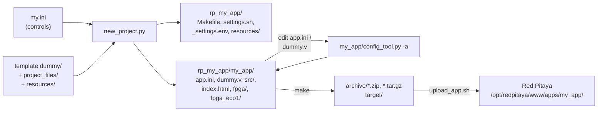
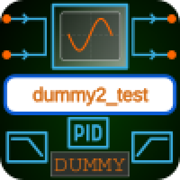
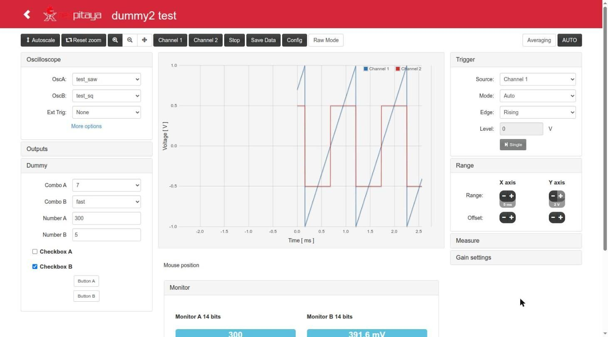
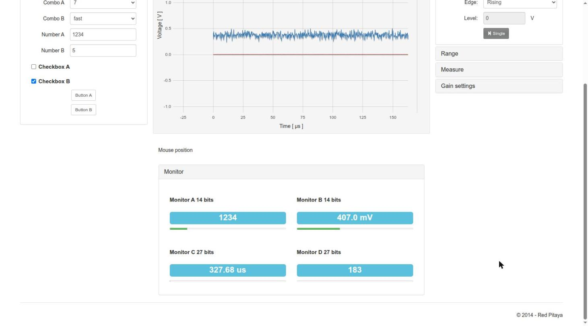
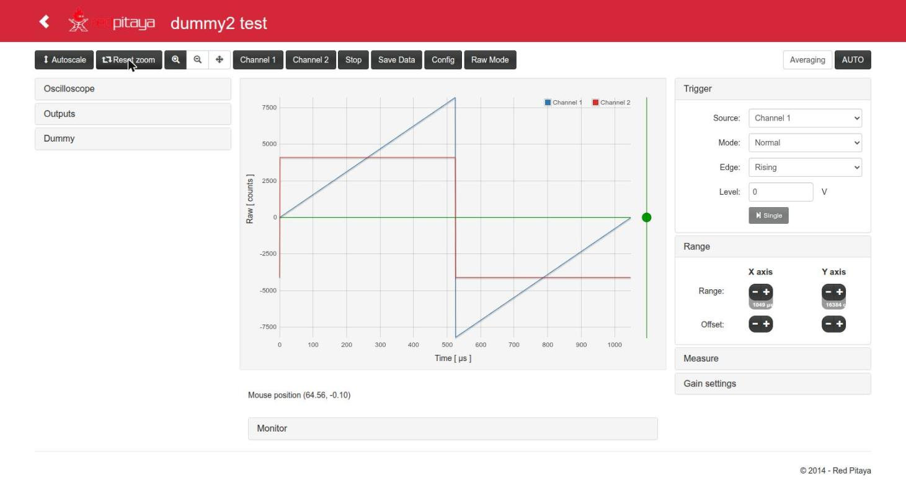
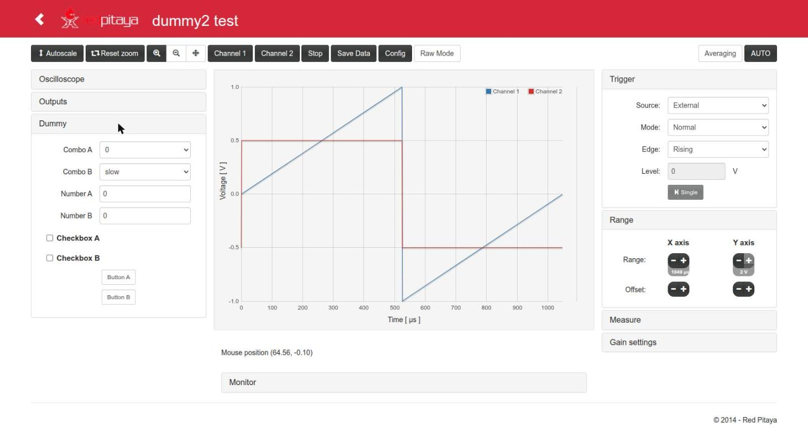
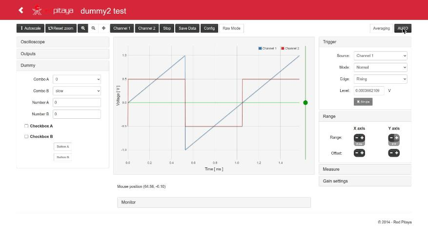
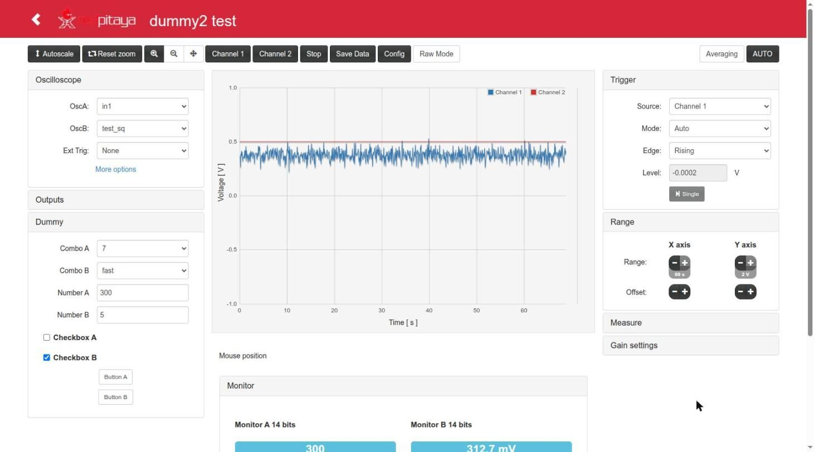
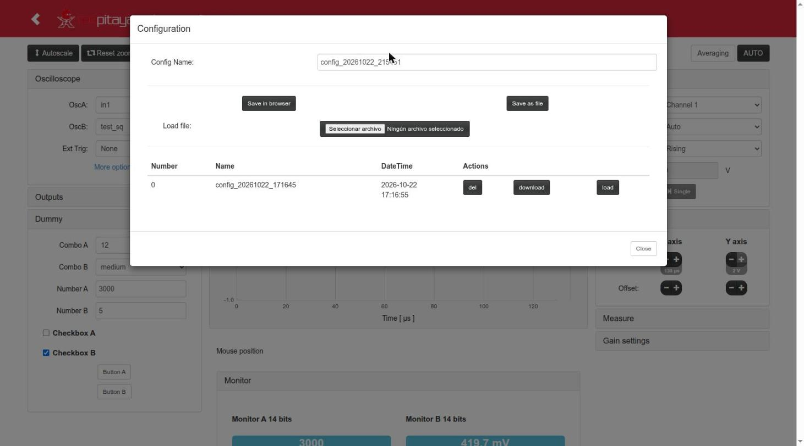

# Usage: create your own Red Pitaya App

> Documented version: rp_dummy2 **2.0.1** (branch `devel2.0`, tag `v2.0.1`). Back to the [README](../README.md).
> Related: [App.md](App.md) (what a generated App contains, registers, scope, Verilog modules),
> [Devel.md](Devel.md) (build and upload), [Remote.md](Remote.md).

The workflow has two tools:

| Tool | Where | What it does |
|---|---|---|
| `new_project.py` | root of this repository | Reads an `.ini` with the controls of the App, validates it and **creates a new standalone project** from the template `dummy/` |
| `config_tool.py` | inside every generated App (`<App>/config_tool.py`) | Keeps the sources of the App in sync with its `<App>/app.ini` after you edit it or instantiate new Verilog modules |



Contents:

1. [`new_project.py`](#1-new_projectpy)
2. [The `.ini` file](#2-the-ini-file)
3. [Validation errors and warnings](#3-validation-errors-and-warnings)
4. [Step by step: your own App](#4-step-by-step-your-own-app)
5. [`config_tool.py`](#5-config_toolpy)
6. [Using the web interface](#6-using-the-web-interface)

---

## 1. `new_project.py`

Python >= 3.8, standard library only (`new_project.py:25-26`). Run it from the repository root (or give the path of the
`.ini` with `-c`).

```
./new_project.py [-h] [-c INI] [-o DIR] [-p PROJECT] [-n] [-f] [-u] [--no-icon]
                 [--icon-tool {auto,cairosvg,rsvg-convert,inkscape}] [-v] [--version] [NAME]
```

| Option | Default | Meaning (source: `new_project.py:324-336`) |
|---|---|---|
| `NAME` | `[general] AppName` of the `.ini` | Name of the App: folder and URL (`http://rp-XXXXXX.local/NAME/`). Letters, digits, `_`, `+`, `-`, starting with a letter (`config_lib.py:1532`) |
| `-c INI`, `--config INI` | `config.ini` | `.ini` with the controls. If the default `config.ini` is not in the current folder, the one next to the script is used (`new_project.py:352-343`) |
| `-o DIR`, `--output DIR` | `.` | Folder where the project folder is created. It must exist |
| `-p PROJECT`, `--project PROJECT` | `rp_NAME` | Name of the project folder (same character rules as `NAME`) |
| `-n`, `--dry-run` | | Only check the `.ini` and print the register map; writes nothing |
| `-f`, `--force` | | Replace the project folder if it exists, **only** if it is empty or looks like a project made by this script (a subfolder with `app.ini` + `config_tool.py`, `new_project.py:280-271`) |
| `-u`, `--settings-only` | | Only (re)write `_settings.env` of an existing project from `[general] rp_host`, `ssh_opts`, `scp_opts` |
| `--no-icon` | | Do not render the logo: the App uses the generic `resources/logo.png` (the name is still written in `resources/logo.svg`) |
| `--icon-tool` | `auto` | Tool that renders `resources/logo.svg`: `auto` = the first available of `cairosvg` (Python module), `rsvg-convert` (`librsvg2-bin`), `inkscape` |
| `-v`, `--verbose` | | Also show the output of `config_tool.py -a` |
| `--version` | | Print the version of the generator (`rp_dummy2 2.0.1`) |

`./new_project.py -h` also lists every key of the `.ini` (§2). The version of the generator is written in the
`info/info.json` (description), `README.md` and `CHANGELOG.md` of every generated App.

**Exit status** (`new_project.py:48`, verified running the script):

| Code | Meaning | Examples |
|---|---|---|
| 0 | OK | generation done, `-n`, `-u`, `-h` |
| 1 | Error in the `.ini` (nothing written) | file not found, invalid key value, reserved name |
| 2 | Bad arguments | unknown option; project folder exists without `-f`; output folder missing; invalid project name; `-f` on a folder that was not made by the script |
| 3 | Generation failed (the temporary folder is removed: nothing is created) | `config_tool.py -a` failed, file system error |

### What it creates

The generation is atomic: everything is built in `<DIR>/.<PROJECT>.tmp/` and renamed at the end; on any error the
temporary folder is removed (`new_project.py:157-264`). The six steps it prints:

```
[1/6] Copying the template .../rp_dummy2/dummy -> my_app/
[2/6] Project files: Makefile, settings.sh, _settings.env, resources/, README.md, CHANGELOG.md, LICENSE, .gitignore
[3/6] App name "my_app": app.ini, index.html, info.json, fpga.conf, fpga.sh, nginx.conf, upload_app.sh
[4/6] FPGA blocks of Red Pitaya: signal generator removed (bus stub), PIDs removed (bus stub)
[5/6] Logo: App name in resources/logo.svg -> resources/logo.png (100x100) -> my_app/info/icon.png
      rendered with rsvg-convert
[6/6] Registers -> dummy.v, C controller, web page, py/hugo.py, tcl: my_app/config_tool.py -a
```

1. Copies `dummy/` without build products (`.so`, `obj/`, bitstreams, Vivado folders, binaries of `c/`;
   `new_project.py:51-67`).
2. Fills the templates of `project_files/` (`Makefile`, `README.md`, `CHANGELOG.md`, `.gitignore` with the App name and
   date) and copies `settings.sh`, `LICENSE`, `resources/`; writes `_settings.env`.
3. Writes the App name in: `app.ini` (copy of your `.ini`, comments included, with `AppName` set), `index.html`
   (`app_id`, the key of the saved configurations, page title), `info/info.json`, `fpga.conf`, `fpga.sh` and
   `nginx.conf` (paths of the bitstream and of the `c/` tools, locations of the endpoints), `src/main.c` (`APP_DIR`:
   the controller stops the streaming tools of the App when it exits) and `upload_app.sh`.
4. Includes or removes the PID block of Red Pitaya (`include_pids`) in the FPGA top, the C controller and the web page;
   the signal generator is always removed in this version (see [`include_genfun`](#general)).
5. Logo: see [step 4.6](#46-logo).
6. Runs `<App>/config_tool.py -a`: registers in `dummy.v`, C controller, register tables of the `c/` tools, web page,
   `py/hugo.py`, tcl scripts and `c/names_dic.txt`.

The resulting layout is described in [Devel.md](Devel.md#layout-of-a-generated-project).

### Examples (real outputs)

Check an `.ini` and see the register map (`config.ini` of this repository):

```
$ ./new_project.py -n
Reading .../rp_dummy2/config.ini
App "my_app": 12 controls (2 combo, 2 number, 2 checkbox, 2 button, 4 monitor); signal generator: no, PIDs: no
Register map (fixed): template registers at 0x000-0x0FC (read_ctrl 0x050, streaming stream_ip/port/rate/cmd 0x054-0x060), controls from 0x100
  address      offset  register         type      bits  range                      label
  0x40600100   0x100   comboA           combo        4  0 .. 15                    Combo A
  0x40600104   0x104   comboB           combo        2  0 .. 3                     Combo B
  0x40600108   0x108   numberA          number      14  -8192 .. 8191              Number A
  0x4060010C   0x10C   numberB          number      14  -8192 .. 8191              Number B
  0x40600110   0x110   checkboxA        checkbox     1  0 .. 1                     Checkbox A
  0x40600114   0x114   checkboxB        checkbox     1  0 .. 1                     Checkbox B
  0x40600118   0x118   buttonA          button       1  0 .. 1                     Button A
  0x4060011C   0x11C   buttonB          button       1  0 .. 1                     Button B
  0x40600120   0x120   monitorA         monitor     14  -8192 .. 8191              Monitor A 14 bits
  0x40600124   0x124   monitorB         monitor     14  -8192 .. 8191              Monitor B 14 bits
  0x40600128   0x128   monitorC         monitor     27  -67108864 .. 67108863      Monitor C 27 bits
  0x4060012C   0x12C   monitorD         monitor     27  -67108864 .. 67108863      Monitor D 27 bits
Dry run: nothing written (the project would be .../rp_dummy2/rp_my_app)
```

Create the project, then update the board address later:

```bash
./new_project.py -c my.ini -o ~/rp my_app        # -> ~/rp/rp_my_app/my_app/
./new_project.py -c my.ini -o ~/rp -f my_app     # regenerate it from scratch (your edits in it are lost!)
./new_project.py -c my.ini -o ~/rp -u my_app     # only rewrite ~/rp/rp_my_app/_settings.env
./new_project.py -c my.ini -o ~/rp -p lab_box my_app   # project folder ~/rp/lab_box/, App my_app
```

> Creating the project inside this repository works (it warns), and `.gitignore` ignores `/rp_*/`; still, prefer
> `-o` with a folder outside it.

---

## 2. The `.ini` file

Standard INI syntax (Python `configparser`): comments with `#` or `;` at the start of the line (inline comments are not
allowed: they would become part of the value, `config_lib.py:1600`). Keys are case-insensitive; **section names are
case-sensitive** (they are the register names). `config.ini` of this repository is a commented example with every key;
the reference is `config_lib.py:1452-1480` (format) and `load_app_ini()` (`config_lib.py:1593-1764`, validation).

### `[general]`

| Key | Values | Default | Meaning |
|---|---|---|---|
| `AppName` | letters, digits, `_ + -`, starting with a letter | (required unless `NAME` is given) | Name of the App. The `NAME` argument replaces it |
| `include_pids` | `True/False` (also `1/0`, `yes/no`, `on/off`) | `False` | Include the 2 PID controllers of Red Pitaya (bus `0x40300000`; their outputs are added to OUT1/OUT2, `red_pitaya_top.sv:471-472`) and their panel in the web page. Without them the bus slot answers 0 (`sys_bus_stub_ok`, `red_pitaya_top.sv:723-727`) |
| `include_genfun` | `True/False` | `False` | Signal generator (ASG) of Red Pitaya. **Not available in this version**: `True` gives a warning and it is not included (the 2020.1 FPGA has no ASG, `config_lib.py:1624-1631`) |
| `register_map` | `fixed` / `legacy` | `fixed` | `fixed`: template registers at `0x000-0x0FC`, controls from `0x100` in the order of the file. `legacy`: controls right after the template registers (from `0x050`) and `read_ctrl` + `stream_*` after them (layout of the old rp_dummy). See [App.md](App.md#register-map-of-the-dummy-module) |
| `rp_host` | host name or IP | `rp-XXXXXX.local` | Board for `make upload` (written to `_settings.env` as `RPIP`) |
| `ssh_opts` | ssh options | `-l root -p 22` | `RPOPTS` of `_settings.env` |
| `scp_opts` | scp options | `-P 22` | `RPSCP` of `_settings.env` |

Unknown keys give a warning and are ignored.

### One section per control

The section name is the **register name** in `dummy.v`, the C controller (`DUMMY_<NAME>`) and the web page
(`dummy_<name>`). Letters, digits and `_`, starting with a letter; it must not be a Verilog/SystemVerilog, C, JavaScript
or Python keyword, nor a name of the template (`in1`, `out1`, `oscA_sw`, `trig_sw`, `read_ctrl`, `clk`, `rst`,
`cnt_clk`, `stream_*`... full list in `config_lib.py:1497-1510`). Two names that differ only in case are rejected.

Control types (`config_lib.py:1482-1489`):

| `type` | Web element | `bits_number` | `signed` | In `dummy.v` | Notes |
|---|---|---|---|---|---|
| `combo` | select box | 1..8 (required) | always unsigned | `reg` written by the page | Options: `options`, or the inputs of a muxer that it selects (see [5.3](#53-texts-of-the-combo-boxes)), or the numbers |
| `number` | integer input with min/max | 1..32 (required) | `True/False` | `reg` | The controller keeps the values as `float`: above 24 bits the values beyond ±2^24 are not exact (warning) |
| `checkbox` | checkbox | always 1 | | `reg` | |
| `button` | toggle button | always 1 | | `reg` | Each click toggles the register between 0 and 1 (highlighted = 1). For a one-clock pulse, detect the edge in `dummy.v` |
| `monitor` | read-only value with a bar | 1..32 (required) | `True/False` | `wire`: **you assign it** | Read by the controller and shown in the page (bars refresh about every 350 ms) |

Keys of a control:

| Key | Types | Default | Meaning |
|---|---|---|---|
| `type` | all | (required) | `combo`, `number`, `checkbox`, `button`, `monitor` |
| `label` | all | section name | Text in the web page (must not contain `<`, `>` or `'`) |
| `bits_number` | combo, number, monitor | (required) | Width of the register. Range: unsigned `0 .. 2^n-1`, signed `-2^(n-1) .. 2^(n-1)-1` |
| `signed` | number, monitor | `False` | Two's complement value |
| `default` | all but monitor | `0` | Value after reset, in the FPGA, the controller and the page. Decimal or with prefix (`0x10`, `0b101`); must be in range |
| `options` | combo | | `options = off, slow, medium, fast`: texts of the values 0, 1, 2... (at most `2^bits_number`; no empty item nor `<`/`>`) |
| `display` | monitor | `int` | `int`: the integer; `volts`: value/8192 in V (scale of the 14-bit ADC/DAC signals, 8192 counts = 1 V); `scaled`: implied by `scale` |
| `scale` | monitor | | Shows `value * scale`; finite, non zero |
| `unit` | monitor | | Unit for `scale` (SI prefixes are added: ns, us, ms...); up to 12 letters, digits, `%`, `/`, `.`, `_`, `-`, spaces. With `volts` it replaces `V` |

In **Raw Mode** of the page every monitor shows the integer, whatever its `display`.

### `[names]` (optional)

Texts of the **inputs of the muxers** of `dummy.v` in the combo boxes: `wire = text` (the wire or expression connected to
the muxer input). It applies to the template selects (Osc A/B, Out1/2, slow outputs) and to the combos of the `.ini`
used as the `.sel` of a muxer. Without an entry, the text is the `label` of the control with that name (e.g. `numberA`
-> "Number A"), else the wire name. Texts must not be empty nor contain `<`, `>` or `'`. Details in
[5.3](#53-texts-of-the-combo-boxes).

### Complete example

```ini
[general]
AppName      = my_filter
include_pids = False
register_map = fixed
rp_host      = rp-XXXXXX.local

# combo: selects the input of a muxer in dummy.v (texts from [names])
[source]
type        = combo
label       = Source
bits_number = 3

# combo with explicit texts
[tau]
type        = combo
label       = Time constant
bits_number = 4
options     = 131 us, 262 us, 524 us, 1.05 ms, 2.1 ms, 4.2 ms, 8.4 ms, 16.8 ms
default     = 3

[offset]
type        = number
label       = Offset [counts]
bits_number = 14
signed      = True
default     = 0

[bypass]
type        = checkbox
label       = Bypass filter

[clear]
type        = button
label       = Clear counter

[level]
type        = monitor
label       = Filtered level
bits_number = 14
signed      = True
display     = volts

[elapsed]
type        = monitor
label       = Time since clear
bits_number = 32
# 125 MHz clock ticks -> seconds
scale       = 8e-9
unit        = s

[names]
in1      = IN1 (ADC)
in2      = IN2 (ADC)
```

---

## 3. Validation errors and warnings

The `.ini` is validated **before anything is written**; every problem is reported at once and the exit status is 1.
Example with a deliberately bad file (real output):

```
ERROR in the configuration:
  App name "9bad": use letters, digits, "_", "+" or "-", starting with a letter
  [general] register_map = weird: use fixed or legacy
  [in1]: "in1" is a reserved name (used by the template or a keyword)
  [cA]: bits_number = 9 out of range for combo (1..8)
  [cB]: 5 options do not fit in 2 bits
  [nA]: default = 200 out of range (-128..127)
  [mB]: scale must be a finite number other than 0
  [x]: type = "slider" unknown, use one of: combo, number, checkbox, button, monitor
  [NA]: same name as [nA] (names must differ in more than the case)
```

Other errors: missing `[general]`, no App name, `bits_number` missing or not an integer, a non-boolean value, a label or
`[names]` text with `<`, `>` or `'`, an empty option, `display` other than `int`/`volts`/`scaled`, an invalid `unit`.
A common one: a comment at the end of a line is part of the value or of the section name, e.g.
`scale = 8e-9  # ticks` gives `[elapsed]: scale = "8e-9  # ticks" is not a number`; put comments on their own lines.

**Warnings** do not stop the generation (real output):

```
WARNING: [general] foo: unknown key, ignored
WARNING: [general] include_genfun = True: the signal generator (ASG) is not available in the Ecosystem 2.0 FPGA of this version, it is not included
WARNING: [nA]: 30 bits: the controller keeps values as float (24 bits of mantissa), values beyond +-2^24 are not exact
WARNING: [nA]: options is only for combo, ignored
WARNING: [mA]: a monitor has no default, ignored
WARNING: [mA]: display = volts: scale ignored (1/8192)
WARNING: [chk] color: unknown key, ignored
WARNING: [chk]: a checkbox always has 1 bit, bits_number ignored
WARNING: [cmb]: a combo is unsigned, signed ignored
```

---

## 4. Step by step: your own App

### 4.1 Describe the controls and generate

```bash
cp config.ini ~/my_filter.ini        # start from the example, edit it
./new_project.py -n -c ~/my_filter.ini            # check it
./new_project.py -c ~/my_filter.ini -o ~/rp       # -> ~/rp/rp_my_filter/my_filter/
cd ~/rp/rp_my_filter
git init                                          # optional: the project has its own .gitignore
```

### 4.2 Write your logic in `dummy.v`

Open `<App>/fpga/prj/v0.94/rtl/dummy.v`. The parts between `[... DOCK]` and `[... DOCK END]` markers are rewritten by
`config_tool.py`; **everything else is yours and is kept**. Landmarks (line numbers of the template
`dummy/fpga/prj/v0.94/rtl/dummy.v`):

| Where | What |
|---|---|
| `module dummy(...)` (l. 20) | Ports: `clk`/`rst` (125 MHz ADC clock), `in1`/`in2` (14-bit signed ADC), `external_trigger` (DIO0_P), `out1`/`out2`, `osc1`/`osc2`, `trigger`, `digital_modulation`, PWM configuration of the slow DACs, system bus |
| `[WIREREG DOCK]` | Declarations of the registers: one `reg` per control and one `wire` per monitor |
| `[ADDED REGS DOCK]` (l. 83) | Comment with the list of your registers: name, address, width, sign, range, `reg`/`wire` |
| "First of all, ALWAYS, write down cable definitions" (l. 91) | Declare your wires here. The file uses `` `default_nettype none `` (l. 17): an undeclared name is an error, not a silent 1-bit wire |
| "NOW CONNECT CABLES AND MODULES" (l. 109) | Instantiate modules and write your logic |
| Scope muxers (l. 136, 178) | 32 inputs each, selected by Osc A / Osc B: connect your signals to `in3..in31` |
| Out1/Out2 muxers (l. 227, 251) | 16 inputs each, selected in the Outputs panel |
| Slow outputs (l. 295-425) | Slow out 3/4 muxers; slow out 1/2 fixed at 0 V |
| `trigger_signals` (l. 434) | Up to 8 trigger sources for Ext Trig (bit 0 = DIO0_P) |
| `[FPGA MEMORY DOCK]` (l. 462) | Bus read/write of all the registers (generated) |

The registers of the controls are already written by the web page; monitors are `wire`s that you must drive
(`new_project.py` leaves a commented `// assign monitorX = 0 ;` for each one after the "NOW CONNECT CABLES AND
MODULES" header: replace them by your signals). Example
for the `.ini` of section 2 (a low-pass filter on a selectable input, a counter, monitors):

```verilog
    // -----------------------------------------------------------------------------------------
    // First of all, ALWAYS, write down cable definitions
    // -----------------------------------------------------------------------------------------
    wire signed [14-1:0] src_sig, filt_sig, filt_out ;
    wire        [32-1:0] cnt_q ;

    // -----------------------------------------------------------------------------------------
    // NOW CONNECT CABLES AND MODULES
    // -----------------------------------------------------------------------------------------
    // combo "source" (3 bits) selects the input of this muxer -> its options become
    // "0", "IN1 (ADC)", "IN2 (ADC)", "Offset [counts]", "0", "0", "0", "0"
    muxer3 #(.RES(14)) i_mux_source (
        .sel ( source ),
        .in0 ( 14'b0  ), .in1 ( in1 ), .in2 ( in2 ), .in3 ( offset ),
        .in4 ( 14'b0  ), .in5 ( 14'b0 ), .in6 ( 14'b0 ), .in7 ( 14'b0 ),
        .out ( src_sig ) );

    filtro_pasabajos #(.R(14), .TAU_OFFSET(14)) i_lpf (
        .clk(clk), .rst(rst), .tau(tau), .dis(bypass), .in(src_sig), .out(filt_sig) );

    UniversalCounter #(.N(32)) i_elapsed (
        .clk(clk), .reset(rst), .en(1'b1), .up(1'b1), .syn_clr(clear), .load(1'b0), .d(32'b0),
        .q(cnt_q), .max_tick(), .min_tick() );

    assign level   = filt_sig ;
    assign elapsed = cnt_q ;
```

(This example was generated from the `.ini` of section 2, completed with `config_tool.py -a` and checked with the
Vivado 2020.1 simulator compiler, `xvlog` + `xelab`, without errors; not synthesized nor run on a board.)

> `config_tool.py` recognizes a combo as the select of a muxer only when the instance is of a module whose name
> contains `muxer` and its port is exactly `.sel( name )` (`get_muxer_inputs()`, `config_lib.py:1195-1218`). With an
> expression such as `.sel({1'b0, source})` the combo shows the numbers: use a muxer whose `sel` width matches the
> combo (`muxer3`/`muxer_reg3` = 3 bits, `muxer4`/`muxer_reg4` = 4 bits, `muxer5`/`muxer_reg5` = 5 bits) or give
> `options` in the `.ini`. Inputs written as `14'b0` are shown as `0` (`parse_sw()`, `config_lib.py:1180`).

To see your signals in the oscilloscope, connect them to free inputs of the scope muxers, e.g. in `i_muxer5_scope1`
replace `.in3 ( 14'b0 )` by `.in3 ( filt_sig )`; after `config_tool.py -a` the Osc A combo shows "filt_sig" (or the text
of `[names] filt_sig = ...`). The same for Out1/Out2 (`out1_sw_m`, `out2_sw_m`).

The modules available in `fpga/prj/v0.94/rtl/dummy/` (ports, parameters, examples) are in
[App.md](App.md#library-of-verilog-modules). Your own modules go in the same folder.

### 4.3 Resynchronize with `config_tool.py`

Run it after **any** of these:

- you edited `<App>/app.ini` (controls added, removed, renamed, other widths, labels, options, `[names]`);
- you instantiated in `dummy.v` a module of `fpga/prj/v0.94/rtl/dummy/` (it must be added to the Vivado tcl scripts);
- you connected signals to the muxers of `dummy.v` (texts of the combos).

```bash
./my_filter/config_tool.py -a
```

Details, change reports and `--rename`: [section 5](#5-config_toolpy).

### 4.4 Build

```bash
source settings.sh          # Linaro toolchain (+ Vivado 2015.2, only needed by make eco1)
LANG=C make                 # controllerhf.so + FPGA (Vivado 2020.1, ~22 min) + archive/*.zip, *.tar.gz
```

Partial builds (`make -C my_filter app`, `fpga`, `eco1`...), outputs and timing notes: [Devel.md](Devel.md#compiling).

### 4.5 Upload and open

```bash
cd my_filter/target
./upload_app.sh -r rp-XXXXXX.local     # -r: restart nginx if the nginx.conf of the App is new or changed (2.0)
```

or `make upload` with `RPIP` set in `_settings.env`. Close the App on the board before uploading it. Then open
`http://rp-XXXXXX.local/my_filter/` (or the App icon in the Red Pitaya menu). Details and safety notes:
[Devel.md](Devel.md#upload-to-the-red-pitaya).

### 4.6 Logo

`resources/logo.svg` of the project is a generic logo with a text element `id="AppName"` (placeholder
`APP NAME LONG`). `new_project.py` (step 5/6) writes the App name there and renders a 100x100 PNG to
`resources/logo.png`, copied to `<App>/info/icon.png` (the icon of the App in the Red Pitaya menu). Long names get a
smaller font, two lines or an ellipsis (`config_lib.py:2213-2250`). Renderers, in order: Python module `cairosvg`,
`rsvg-convert`, `inkscape` (`--icon-tool` forces one). Without any of them a warning says what to install
(`pip install cairosvg`, `sudo apt install librsvg2-bin` or `sudo apt install inkscape`) and the generic logo is used.



To change the logo, edit `resources/logo.svg` (keep the element with `id="AppName"`) and run
`./<App>/config_tool.py -l`.

---

## 5. `config_tool.py`

`<App>/config_tool.py` regenerates the automatic parts ("docks") of the App sources from `<App>/app.ini` (the same
validation as `new_project.py`). The code you wrote outside the docks is not touched. Running it twice without changes
leaves the files unchanged (tested in `tests/generator_test.py`).

| Option | What it writes (`config_tool.py:3-20`) |
|---|---|
| `-v`, `--do-verilog` | `fpga/prj/v0.94/rtl/dummy.v`: declarations, bus read/write (registered read copies of the read-only registers, `BUS READ COPIES`), `ADDED REGS` list |
| `-m`, `--do-main` | `src/`: register struct (`fpga_dummy.h`, padded to the fixed addresses with `_Static_assert`), parameter table (`main.c`, `main.h`), FPGA <-> parameters copy (`dummy.c`, `fpga_dummy.c`), mapped size `DUMMY_BASE_SIZE`; `c/`: register table of `c/dummy` (`c/dummy.c`), `c/dummy.txt` (CSV), `c/app_regs.h` (offsets for the streaming tools) |
| `-w`, `--do-html` | `index.html`: panels of the controls and monitors, JS lists of controls, monitor scales/units |
| `-p`, `--do-python` | `py/hugo.py`: register list for Python scripts running on the board |
| `-t`, `--do-tcl` | Vivado scripts: files of `fpga/prj/v0.94/rtl/dummy/` with the modules instantiated in `dummy.v` |
| `-n`, `--names` | `c/names_dic.txt`: text of every value of every combo box |
| `-a`, `--all` | all of the above (`-v -m -w -p -t -n`) |
| `--rename OLD:NEW` | A control was renamed in `app.ini`: rename it also in your code before regenerating (repeatable) |
| `-l`, `--logo` | Logo only (not part of `-a`): App name on `../resources/logo.svg` -> `logo.png`, `info/icon.png` |

Exit status: 0 OK (also "nothing to do" without options), 1 error in `app.ini`, 2 bad `--rename`
(`config_tool.py:100-104, 205-216`).

### 5.1 Modules -> tcl scripts (`-t`)

The instances in `dummy.v` (comments ignored) are resolved to files of `fpga/prj/v0.94/rtl/dummy/`, recursively inside
those modules, and only those files are listed in the automatic blocks of `fpga/red_pitaya_vivado_Z10.tcl` (Vivado 2020.1)
and `fpga_eco1/red_pitaya_vivado.tcl` / `red_pitaya_vivado_project.tcl` (2015.2) (`config_tool.py:442-469`,
`config_lib.py:2123`). The `.dat` files (memory contents) are always included. Real output after adding a counter, a
filter and a muxer:

```
do_tcl
Modules instantiated in dummy.v (and in them): UniversalCounter (UniversalCounter.v), filtro_pasabajos (filtro_pasabajos.v), muxer4 (muxer4.v), muxer_reg5 (muxer_reg5.v), pipe_mult (pipe_mult.v), muxer_reg4 (muxer_reg4.v), aDACdecoder (aDACdecoder.v)
Files of dummy/ not used (not added): dummy_debounce.v, filtro_pasaaltos.v, fun_icdf.v, fun_pico.v, gen_mod.v, gen_ramp.v, mult_dsp_14.v, muxer3.v, muxer5.v, muxer_reg3.v, rand_gen_uni.v, satprotect.v, signo.v, sum_2N.v, trigger_input.v
Writting file: fpga/red_pitaya_vivado_Z10.tcl
```

Warnings: a module found nowhere (the synthesis would fail), a module defined in two files (the first one is used), and
a module whose name clashes with the RedPitaya design (e.g. `debounce`: that is why the library has `dummy_debounce`).

### 5.2 Changes of `app.ini`

Before writing, the registers of the last generation (the `ADDED REGS` block of `dummy.v`) are compared with `app.ini`
(`config_lib.py:1903`). Real output after removing `[numberB]` and renaming `[monitorD]` to `[monitorE]` in the App of
the example `config.ini`:

```
Changes of app.ini since the last generation (ADDED REGS of dummy.v):
    added    : monitorE
    removed  : numberB   WARNING: its register and wire disappear from dummy.v, the C controller and the web page
    removed  : monitorD   WARNING: its register and wire disappear from dummy.v, the C controller and the web page
    address  : checkboxA 0x110 -> 0x10C   WARNING: scripts that use the old address must change
    ...
    address  : monitorC 0x128 -> 0x124   WARNING: scripts that use the old address must change
    renamed? : monitorD -> monitorE (same width and kind): if so, run again with --rename monitorD:monitorE so that the user code is renamed too
```

With the `fixed` map the controls take **consecutive addresses from `0x100`**: removing or inserting a control moves the
next ones. To keep addresses stable, add new controls at the end of the file.

After writing, every line of your code (`dummy.v`, own code in `index.html`, `src/`, `py/`) that still uses a removed
register is reported, and it keeps being reported (it is remembered in the `ADDED REGS` block) until you fix it:

```
$ ./my_app/config_tool.py -a --rename monitorD:monitorE
--rename monitorD:monitorE: 2 replacement(s) in fpga/prj/v0.94/rtl/dummy.v
WARNING: fpga/prj/v0.94/rtl/dummy.v:149: uses a register removed from app.ini: .in0(14'b0), .in1(in1), .in2(in1_slow), .in3(numberA), .in4(numberB),
WARNING: fpga/prj/v0.94/rtl/dummy.v:157: uses a register removed from app.ini: assign monitorE = {{13{numberB[13]}}, numberB} ;
         (remove or change that code; if the control was renamed, use --rename OLD:NEW)
```

`--rename OLD:NEW` requires that `app.ini` already has `[NEW]` and no longer has `[OLD]`. It replaces whole words in
`dummy.v`, `dummy_OLD` in `index.html` and `DUMMY_OLD` / `dummy_old` / `->old` in `src/` (`config_lib.py:2002`).

### 5.3 Texts of the combo boxes

For each combo of `app.ini` (`config_tool.py:379-387`):

1. `options = ...` of `app.ini`, if given;
2. else, if the register is the `.sel` of a muxer in `dummy.v`, one option per muxer input (up to `2^bits_number`),
   named by `[names]`, else by the label of the control with that name, else by the wire name;
3. else the numbers `0 .. 2^bits_number - 1`.

The template selects (Osc A/B, Out1/2, Slow out 3/4) follow rule 2. An output select whose muxer is not in `dummy.v`
(Slow out 1/2 in the template) shows a single option `0 (no muxer in dummy.v)` (`config_tool.py:362-370`). The Ext Trig
select keeps the options written by hand in `index.html` (see [App.md](App.md#external-trigger)).

Real example: a `muxer4` with `.sel(comboA)` and inputs `14'b0, in1, in1_slow, numberA, numberB, 14'b0...`, with
`[names] in1 = IN1 (ADC)` and `in1_slow = IN1 low-pass`, gives Combo A the options
`0, IN1 (ADC), IN1 low-pass, Number A, Number B, 0, ...`.

### 5.4 `c/names_dic.txt`

One line per value of every combo: `<register> <address> <value> <text>`, with a header comment and the source of each
combo (options of `app.ini`, inputs of its muxer, or options written in `index.html`). It is packaged with the App (in
`c/`) for scripts and tools of the board. Example (generated App of `config.ini`):

```
# oscA_sw: inputs of its muxer in dummy.v
oscA_sw          0x000   0 0
oscA_sw          0x000   1 in1
oscA_sw          0x000   2 in2
...
```

---

## 6. Using the web interface

The page of a generated App is the same for every App; only the **Dummy** and **Monitor** panels depend on the `.ini`.
The screenshots below are from the test App `dummy2_test` (the controls of `config.ini` plus test logic in `dummy.v`:
an internal sawtooth `test_saw` and square wave `test_sq` on Osc A/B inputs 5/6, and the square as an Ext Trig source),
taken on RP2 (Ecosystem 2.04-35) during the tests of CP4 and CP4_bis (`reportes/dummy2/`).



### 6.1 Layout

| Element | Function |
|---|---|
| Top bar | **Autoscale** (Y), **Reset zoom**, zoom in/out/pan tools, **Channel 1/2** (show/hide), **Stop/Run**, **Save Data** (download the traces), **Config** (save/load settings), **Raw Mode**, **Averaging** (average at decimation), **AUTO** (auto-set) |
| Oscilloscope panel | **OscA / OscB**: signal of each scope channel (32-input muxers of `dummy.v`; defaults in1 / in2). **Ext Trig**: external trigger source. *More options*: disable the anti-aliasing filter of Ch1/Ch2 (register `osc_ctrl`) |
| Outputs panel | **Out1 / Out2**: signal on the fast DACs (16-input muxers; default 0 = no output). *Slow outputs*: Slow out 1..4 (only 3 and 4 have a muxer in the template) |
| Dummy panel | Your controls (`.ini`), in the order of the file |
| PID panel | Only with `include_pids = True` |
| Plot | Two channels; mouse position below it |
| Monitor panel | Your monitors (`.ini`): value and a bar |
| Trigger panel | **Source** (Channel 1, Channel 2, External), **Mode** (Auto, Normal, Single), **Edge** (Rising/Falling), **Level** (V; counts in Raw Mode), **Single** button |
| Range panel | X (time window, 1-2-5 steps) and Y ranges and offsets |
| Measure / Gain settings | Measurements of the signals; probe attenuation and LV/HV jumper of each input |

### 6.2 Controls and monitors

- **Combo / checkbox / button**: the value is sent at once. Buttons toggle (highlighted = 1).
- **Number**: type the value and press Enter (or the check button). Escape cancels. Out-of-range values are not sent.
  `.` is the decimal separator (`,` is accepted).
- **Monitors** are read on every refresh of the page and shown as integer, volts or scaled value with unit, as defined
  in the `.ini`; the bar shows the value relative to the full range of the register.



### 6.3 Oscilloscope

- **Time range**: X+/X- buttons of the Range panel, or the mouse wheel. Windows from 131 µs (decimation 1) to about
  68.7 s (decimation 524288); the full list is in [App.md](App.md#time-ranges-and-decimation).
- **Mouse wheel over the plot**: no key = zoom of both axes centred on the mouse; **SHIFT** = time axis only (cursor
  ↔); **ALT** = Y axis only (cursor ↕; Y zoom is local, nothing is sent to the board). One step = 1.5x
  (`index.html` `[PLOT WHEEL]`, l. 2821-2981). Some Linux window managers take ALT + wheel for themselves.
- **Reset zoom**: X = one whole memory of the scope (16384 samples) at the current decimation, from t = 0; Y = -1..1 V
  (Raw Mode: -8192..8192). The decimation does not change (`resetZoom()`, `index.html` l. 3857).
- **Raw Mode**: Y axis and monitors in integer counts (8192 counts = 1 V for the 14-bit signals); the Y axis autoscales
  when it is toggled.



- **Trigger**: Auto (free running when there is no trigger), Normal (waits for the trigger), Single (one acquisition,
  armed with the Single button). Level in V, or in ADC counts in Raw Mode (-8192..8191, the unit next to the box says
  which; values out of range are limited; switching Raw Mode converts the level and the Y axis, so the trigger and
  the view stay on the same part of the signal; AUTO in Raw Mode gives the level and the Y range in counts).
  Pre-trigger: move the window to negative times.
- **Ext Trig**: choosing a value other than None sets Source = External and Mode = Normal at once (also from Single);
  going back to None changes nothing else. Loading a configuration or restoring the page does not apply this rule.



- **AUTO**: looks for a periodic signal and sets the trigger (Normal, channel with signal, level) and a window with a
  few periods; with a DC signal it sets Mode = Auto. It finishes in a few seconds at most (every wait has a time limit
  in the controller, `src/worker.c`; tested on RP2: < 2.5 s, `reportes/dummy2/2026-10-23_cp4_bis_test.md` B6).



- Long windows: at decimation 524288 one acquisition lasts about 69 s; the trace grows from the left while it is
  acquired.



### 6.4 Configurations and page state

- **Config**: save the settings in the browser (with a name), download them as a `.json` file, load a file, delete or
  load a saved one. Configurations are stored per App (`config_storage_key` set by `new_project.py`).
- The page restores its state after a reload; when another browser takes control of the App, the page says so.
- Ecosystem 2.0 details handled by the page: parameters are sent in POSTs of at most 600 bytes (`index.html` l. 65),
  with retries; `index.html` is not cached (`nginx.conf`).


